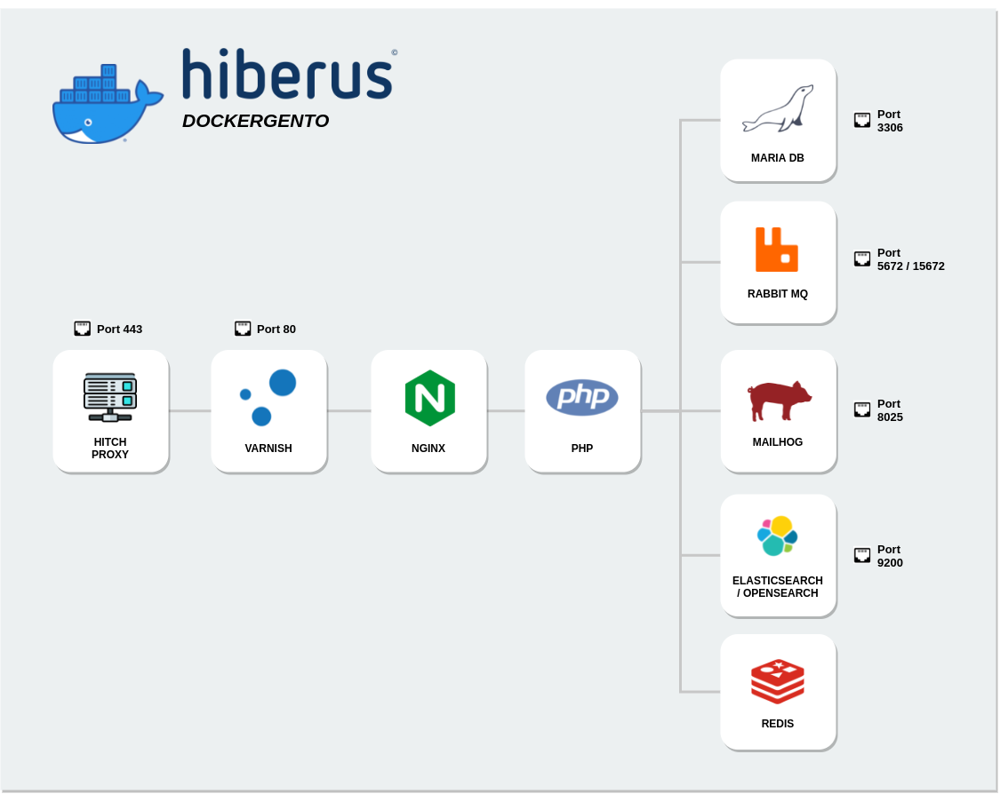

<div align="center">


# Hiberus Dockergento

**Docker environments for Magento 2, driven by one command: `hm`.**

[](https://github.com/hiberus-magento/hiberus-dockergento/actions/workflows/go.yml)
[](https://github.com/hiberus-magento/hiberus-dockergento/releases)
[](go.mod)
[](LICENSE)
<br>
[](https://hub.docker.com/u/hiberusmagento)
[](docs/versions.md)
[](docs/installation.md#requirements)

[Quickstart](#quickstart) · [Why hm](#why-hm) · [Documentation](docs/README.md) · [Contributing](CONTRIBUTING.md)

</div>

<!-- demo: generate it with `vhs docs/assets/demo.tape` (see the header of that file), then uncomment
<p align="center"></p>
-->

`hm` sets up and runs a Magento 2 development environment in Docker without asking you to think
in containers. `hm setup` picks the PHP, MariaDB, search, Redis and Varnish versions that match
your Magento version and writes the Compose files; after that, `hm start`,
`hm magento cache:clean`, `hm composer install` or `hm mysql -i dump.sql` do what they say, inside
the right container.

## Quickstart

You need macOS or Linux and Docker with the Compose v2 plugin
([requirements](docs/installation.md#requirements)).

**1. Install** the single binary (checksum-verified, no git clone):

```bash
curl -fsSL https://raw.githubusercontent.com/hiberus-magento/hiberus-dockergento/main/install.sh | bash
```

> [!NOTE]
> Until 2.0.0 is released, `install.sh` is only on the `release/2.0.0` branch and every 2.x
> release is a candidate, which the installer takes only with `--pre`:
>
> ```bash
> curl -fsSL https://raw.githubusercontent.com/hiberus-magento/hiberus-dockergento/release/2.0.0/install.sh | bash -s -- --pre
> ```

**2. Dockerize** your project, from its directory:

```bash
cd <your_project>
hm setup        # answers a few questions and writes the Docker configuration
```

**3. Start** it:

```bash
hm start        # brings the environment up
hm launch       # opens the storefront in the browser
```

Next: importing a database, starting a new project and troubleshooting are in
[Getting started](docs/getting-started.md). Upgrading from 1.x is in
[Installation](docs/installation.md#upgrading-from-1x).

## Why hm

<p align="center"></p>

| You get | Instead of |
|---|---|
| The right stack for your Magento version, chosen by `hm setup` | Matching PHP, MariaDB, search and Redis versions by hand |
| `hm magento`, `hm composer`, `hm mysql`, `hm bash` run in the right container | Remembering `docker compose exec` lines and service names |
| One self-contained Go binary that talks to the Docker API and uses Compose as a library | A Bash checkout with `jq` and other dependencies to keep in step |
| Every environment on one screen (`hm tui`), one per git branch (`hm worktree`), several up at once behind a shared proxy (`hm proxy`) | Stopping one project to start another |
| Database snapshots (`hm db`), a temporary public address (`hm share`), a diagnosis (`hm doctor`) | Ad hoc dumps, tunnels and guesswork |

### Supported versions

Magento **2.3.0 to 2.4.9**, every patch included. A few of the stacks `hm setup` picks:

| Magento | PHP | MariaDB | Search | Cache |
|---|---|---|---|---|
| 2.4.9 | 8.5 | 12.3 | OpenSearch 3 | Valkey 9 |
| 2.4.8 | 8.4 | 11.4 | OpenSearch 2.5 | Redis 7 |
| 2.4.7 | 8.3 | 10.6 | OpenSearch 2.5 | Redis 7 |
| 2.4.6 | 8.2 | 10.6 | OpenSearch 2.5 | Redis 7 |
| 2.3.7 | 7.4 | 10.3 | Elasticsearch 7.17 | Redis 6.2 |

The full matrix, the images and moving between `hm` releases: [Supported versions](docs/versions.md).

### Built for scripts and AI agents

Every command can be consumed by a person or by a machine (a script, a CI job, an AI agent), with
the same rules everywhere:

- **One JSON envelope** for every answer (`schema_version`, `command`, `ok`, `data` or `error`),
  errors on stderr, and [stable exit codes](docs/output.md#exit-codes) to branch on.
  See [JSON output](docs/json.md).
- **`hm --json`** lists every command with its options and safety level, so an agent can discover
  what exists in one call.
- **`hm status`** says how the environment is doing in one call: containers, URLs, xdebug, mode,
  data and last errors. See [status](docs/status.md).
- **`--dry-run`** on `down`, `clean`, `db restore` and `purge` says what would be removed and
  changes nothing; **`--progress=jsonl`** writes the steps of long commands to stderr as JSON
  lines ([progress](docs/progress.md)); **`--yes`** never waits for input
  ([non-interactive mode](docs/output.md#non-interactive-mode)).
- **`hm mcp`** is a Model Context Protocol server with read-only tools — describe the project,
  list environments, run the diagnosis, read a service's log, run one read-only SQL statement.
  `hm mcp --config` prints the entry to add to your MCP client; `hm mcp --write` also offers a few
  bounded write tools. See [mcp](docs/mcp.md).
- **`hm ai-context`** writes the project context an agent reads before it starts, and
  **`hm permissions`** prints the permission configuration an agent should be given, for Claude
  Code, Codex or OpenCode (`--format=claude|codex|opencode`). See [ai-context](docs/ai-context.md)
  and [permissions](docs/permissions.md).
- **`hm ai-init`**, `hm ai-pull`, `hm ai-reset` and `hm ai-doctor` manage the AI skills and agents
  of a project; `hm ai-init --plugin` writes a Claude Code plugin instead. The skills that teach an
  agent this tool live in `skills/`. See [skills](docs/skills.md) and [ai-init](docs/ai-init.md).

## Documentation

| | |
|---|---|
| [Installation](docs/installation.md) | Install, update, uninstall, upgrade from 1.x, build from source |
| [Getting started](docs/getting-started.md) | First project, troubleshooting, dashboard, proxy, worktrees, shell completion |
| [Commands](docs/README.md#commands) | Every command, grouped as `hm --help` groups them, one page each |
| [Supported versions](docs/versions.md) | The version matrix, the Docker images, `hm switch` and release candidates |
| [Output, exit codes and non-interactive use](docs/output.md) | For scripts, CI jobs and agents |
| [Project commands](docs/project-commands.md) | Add your own `hm <name>` to a project |
| [ARCHITECTURE.md](ARCHITECTURE.md) | How the tool is built: the Go binary, its router, the hexagonal layers |
| [MIGRATION.md](MIGRATION.md) | The history of the move from Bash to Go (in Spanish) |

## Contributing

Bug reports and pull requests are welcome. [CONTRIBUTING.md](CONTRIBUTING.md) has the build, the
tests and the commit conventions.

<a href="https://github.com/hiberus-magento/hiberus-dockergento/graphs/contributors"></a>

### Related projects

[hiberus-magento/ai-tools](https://github.com/hiberus-magento/ai-tools) — AI-powered skills and
agents for Magento 2 that extend AI coding assistants (Claude, Copilot, Cursor, Gemini, etc.) with
expert Magento knowledge. Dockergento integrates with ai-tools to provide an agile, AI-assisted
development workflow.

### Thanks to

- This project is based on [Dockergento](https://github.com/ModestCoders/magento2-dockergento).
  Special thanks to **ModestCoders** for their work.
- Several improvements have been inspired on [Docker-magento](https://github.com/markshust/docker-magento).

## License

[GNU General Public License, version 3 (GPLv3)](LICENSE). [(c) Hiberus Tecnología](https://hiberus.com).

<p align="center"><sub>Made by <a href="https://hiberus.com">Hiberus</a>.</sub></p>
